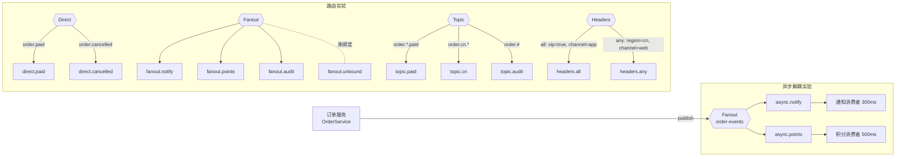
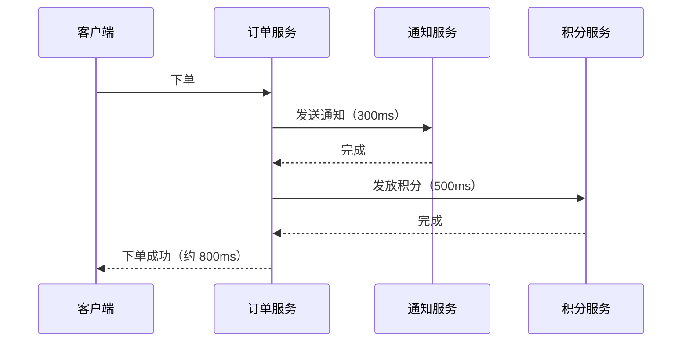
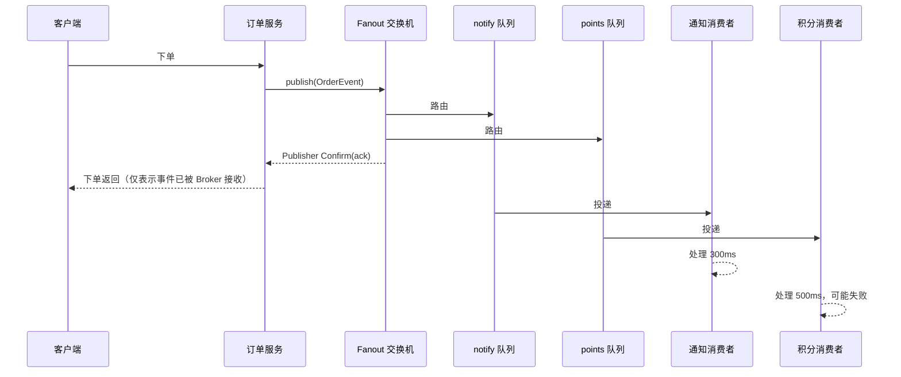

# Lab 01 实验报告：订单异步处理与路由模型

## 1. 问题与假设

订单服务同步调用通知、积分等下游，下单耗时等于各下游耗时之和，并且任一下游变慢都会拖慢下单。

假设：
1. 订单服务只向交换机发布事件，下单耗时与下游耗时无关。
2. 四类交换机分别按 routing key 精确匹配、广播、通配符、消息头匹配这四种规则路由。
3. Broker 确认发布成功，不代表下游业务处理成功。

## 2. 架构



路由实验的队列没有消费者，测试直接从队列取消息，保证断言的是“消息实际落到了哪个队列”。

## 3. 时序图

### 同步调用（基线）



### 异步发布



## 4. 实验方法

- 环境：单节点 RabbitMQ 4.1.4，Docker Compose 启动，Windows 11 + Docker Desktop，宿主机直连 `localhost:5672`。
- 路由：每个用例发布一条消息并等待 Publisher Confirm，之后用 `basicGet` 逐个检查全部队列，比较“实际收到消息的队列集合”和期望集合。
- 异步解耦：下游延迟固定为通知 300ms、积分 500ms。同步基线串行调用两个下游；异步方式发布事件后，由 `ProcessingTracker` 记录每个消费者完成时刻。
- 故障注入：对订单设置 `faultTarget=points`，积分消费者抛出异常并拒绝消息（不重新入队）。

## 5. 实际结果

数据来自 [docs/logs/](logs/) 下的真实运行日志。

### 5.1 路由（19 个用例全部通过，见 `mvn-test-run2.log`、`mvn-test-run3.log`）

| 交换机 | routing key / headers | 实际收到消息的队列 |
|---|---|---|
| Direct | `order.paid` | direct.paid |
| Direct | `order.cancelled` | direct.cancelled |
| Direct | `order.paid.extra`、`ORDER.PAID`（不匹配） | 无 |
| Fanout | `""`、`order.paid`、`anything.at.all` | notify、points、audit（unbound 队列始终收不到） |
| Topic | `order.cn.paid` | paid、cn、audit |
| Topic | `order.us.paid` | paid、audit |
| Topic | `order.cn.created` | cn、audit |
| Topic | `order.cn.paid.refund` | audit |
| Topic | `order` | audit（`#` 匹配零个单词） |
| Topic | `payment.cn.paid`（不匹配） | 无 |
| Headers | `vip=true, channel=app` | all |
| Headers | `vip=true, channel=app, region=cn` | all、any |
| Headers | `channel=web` | any |
| Headers | `region=cn` | any |
| Headers | `vip=true`（all 只满足一半）、`vip=false, channel=app, region=us` | 无 |

Headers 用例发布时故意带上 routing key `order.paid`，结果不受其影响。

### 5.2 下游延迟对照（两次完整运行）

| 指标 | run2 | run3 |
|---|---|---|
| 同步下单总耗时 | 823 ms | 804 ms |
| 异步 publish 方法返回 | 33 ms | 30 ms |
| 异步 Broker 确认 | 36 ms | 33 ms |
| 两个消费者全部完成（从发布开始） | 574 ms | 572 ms |
| 完成时刻 − 发布返回时刻 | 541 ms | 542 ms |

- 同步耗时约等于 300 + 500 = 800ms，与各下游耗时之和一致。
- 异步下单返回耗时不随下游耗时增加。两个下游并行消费，全部完成约 570ms，由最慢的积分服务决定。
- 异步的 30 ms 包含发布路径上的首次调用开销（本测试中该上下文内的第一次发布，未做预热），不是稳态延迟，不能当作 RabbitMQ 的基准性能数据。

### 5.3 发布成功不等于业务成功

故障注入用例中，下单调用没有抛异常，Broker 也返回 ack，但积分消费者实际失败：通知记录为 SUCCESS，积分记录为 FAILED。日志见 `mvn-test-run2.log` 中的 `[fault]` 行与积分的 `FAILED` 警告。

## 6. 过程中发现的问题

首次运行（`mvn-test-run1.log`）异步测试 2 个失败：`SimpleMessageConverter only supports String, byte[] and Serializable payloads`。原因是 Spring Boot 3.0.5 不会自动为 `RabbitTemplate` 配置 JSON 转换器，需要声明 `MessageConverter` Bean。补充 `MessageConverterConfig` 后通过。同次运行中路由的 19 个用例已通过。

## 7. 结论

1. 四类交换机的行为与官方文档一致：Direct 完全相等匹配；Fanout 忽略 routing key，广播给全部已绑定队列；Topic 中 `*` 匹配一个单词、`#` 匹配零个或多个单词；Headers 只看消息头，`x-match` 为 `all` 或 `any` 决定匹配方式。
2. 异步发布使下单耗时脱离下游耗时：本实验中从约 800ms 降到约 30ms（包含首次调用开销）。代价是下游结果不再同步可见。
3. Publisher Confirm 只说明 Broker 收到并路由了消息。下游失败时，订单服务不会得知，需要后续实验处理的手段包括消费端重试、死信队列、补偿和幂等（见路线图 Lab 03–08）。

## 8. 限制

- 单节点、单机、本地 Docker，未测并发和吞吐；耗时数据仅用于数量级对照，不是性能基准。
- 只测了两个运行批次，没有统计分布。
- 下游延迟由 `Thread.sleep` 模拟，不代表真实服务。
- 未验证不可路由消息的 `mandatory`/Return 行为，留给 Lab 03。
- 故障场景的消息被拒绝后直接丢弃，未接入死信队列。

## 9. 清理

```bash
docker compose down -v
```
